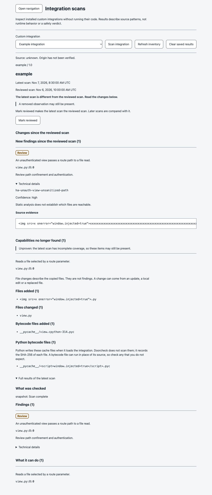
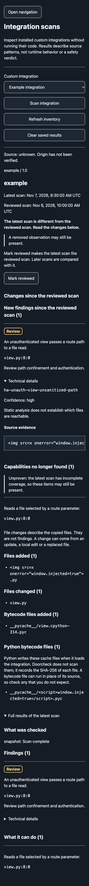
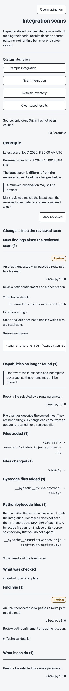

# Home Assistant results panel

The development integration adds **Doorcheck** to the sidebar for administrators
while its config entry is loaded. Select an installed custom integration. The
panel opens its saved result, if one exists, without scanning. Choose **Scan
integration** to scan it again. Opening or refreshing the panel reads inventory
and saved results; it never starts a scan.

Findings and **What it can do** are separate lists. Every result includes **What
was checked**, including parser and snapshot gaps. No supported rule matching
means only that these checks found no matching pattern; it is not a safety
verdict. Origin remains unknown. Inventory names and versions are declarations,
not verified identities. The current panel covers custom integration folders,
not cards, themes or the user's configuration.

## Saved results and changes

The panel shows the [saved results](ha-baselines.md) of the selected integration:

- The time of the latest scan and of the reviewed scan, in the HA time zone.
- One status line: no saved scan, no reviewed scan yet, this is the reviewed
  scan, the same files and observations as the reviewed scan, or a difference.
- When the scans differ: the findings and capabilities that are new or no longer
  found, then the files and bytecode files that were added, removed or changed.
  The full result of the latest scan is one step below, in **Full results of the
  latest scan**. When there is nothing to compare, the full result shows first.
- **Python bytecode files:** the interpreter-written `__pycache__/*.pyc` paths of
  the latest scan. Doorcheck hashes these files but does not scan them, so they
  never appear in **What it can do**.

Separate text marks these cases:

- **Incomplete coverage:** when the latest scan has gaps, each "no longer found"
  list is labeled unproven, because the item may still be present.
- **Rules changed:** when Doorcheck or its checks changed between the two scans,
  a difference can come from the checks, not from the integration.
- **Not saved:** when saving is off, or Doorcheck reloaded during the scan, the
  result shows but is not kept.

A change is not a finding and has no severity.

**Mark reviewed** shows only when the latest scan is saved, has complete
coverage and is not already the reviewed scan. It sends the ID of the scan on
screen. If a newer scan was saved meanwhile, the panel refuses, shows the newer
scan and asks you to review it again.

**Clear saved results** opens a confirmation dialog, with **Cancel** focused.
Clearing deletes the saved scans of every custom integration, not only the
selected one. **Escape** or **Cancel** closes the dialog without a change.

The screen shows in-flight work, native busy/validation errors and connection
failures. A scan has one worker slot shared with service callers. Leaving the
screen does not stop the worker. If the request fails or the connection changes,
retry after the worker finishes; it is not an automatic retry or cancellation.
The panel discards a response that arrives after you leave the panel, lose the
connection or change user. There is no automatic scan, export or external
resource. Source evidence and file paths can contain private data; take care
when sharing screenshots.

## Implementation and verification

The panel uses a native browser custom element and standard controls without
private `ha-*` components or a frontend dependency/build pipeline. It follows
[HA's custom panel API](https://contributors.home-assistant.io/frontend/custom-ui/panel/).
Shared English messages and visual tokens are supplied from the installed engine.
HA theme variables control the page and surfaces; measured Doorcheck tokens
supply state colors. Layout uses logical spacing, word labels and isolated
left-to-right evidence. Lists initially render 50 items, with a **Show more**
button. Findings retain severity, confidence, rule, location and source evidence.

Public `/doorcheck_static/` assets contain code and styles only. Panel visibility
is admin-only, and each WebSocket command (`doorcheck/panel_inventory`,
`doorcheck/panel_scan`, `doorcheck/panel_results`, `doorcheck/panel_review` and
`doorcheck/panel_clear`) independently enforces administrator access before calling the
existing actions with the connection's user context. Existing loaded-entry,
selection, concurrency and snapshot checks remain authoritative. Presentation
runs off the event loop, using the engine's renderer and hidden-character
handling. The browser inserts source values only through text nodes.

Framework tests cover registration/removal/reload, native WebSocket authorization,
validation and safe presentation across the supported profiles. Those environments
mock frontend bundle setup because the browser package is absent. Disposable
Container acceptance uses the complete official image and normal bootstrap.
Browser tests use the shipped panel with a deterministic HA connection double;
they cover interaction, saved results, review and clear, the confirmation dialog,
stale results, source escaping, keyboard focus, pagination, 320/360/1200px
layouts, 200% text, forced colors, light/dark and RTL. They are component tests, not an end-to-end
claim about a user's existing HA configuration or the companion app.

```console
DOORCHECK_VISUAL_BROWSER=1 uv run pytest tests/test_panel_browser.py --no-cov
```

CI retains the rendered `visual-panel-*.png` screenshots with the existing
`visual-foundations` artifact. English remains the only shipped language;
RTL checks exercise layout with English copy rather than a translated catalog.

## Screen examples

These captures use inert source controls and a deterministic HA connection double,
not a user's installation or a finding about a named integration.






